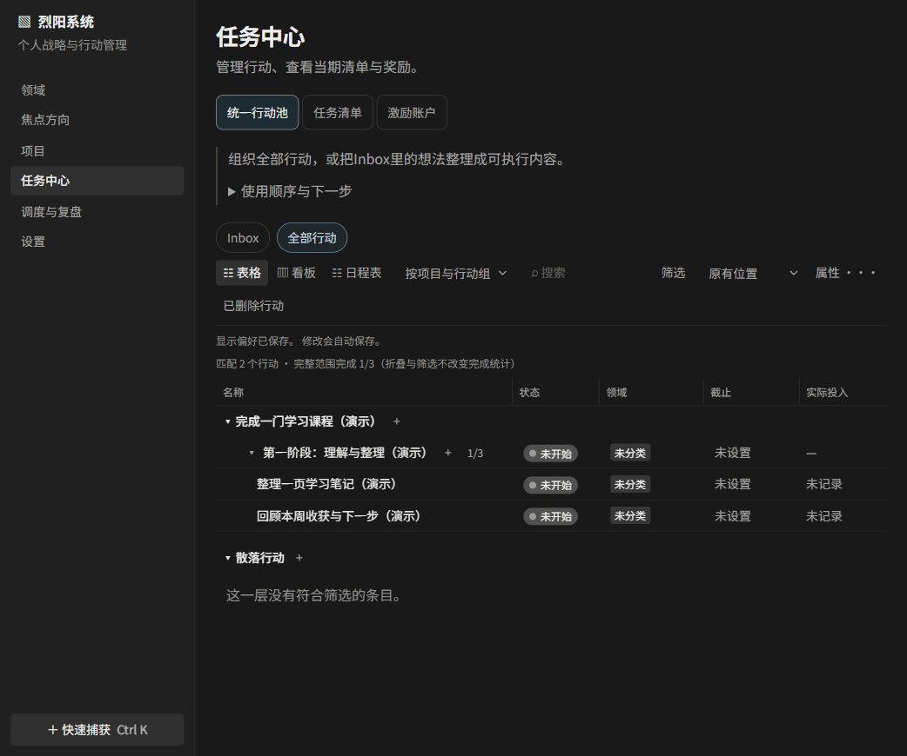
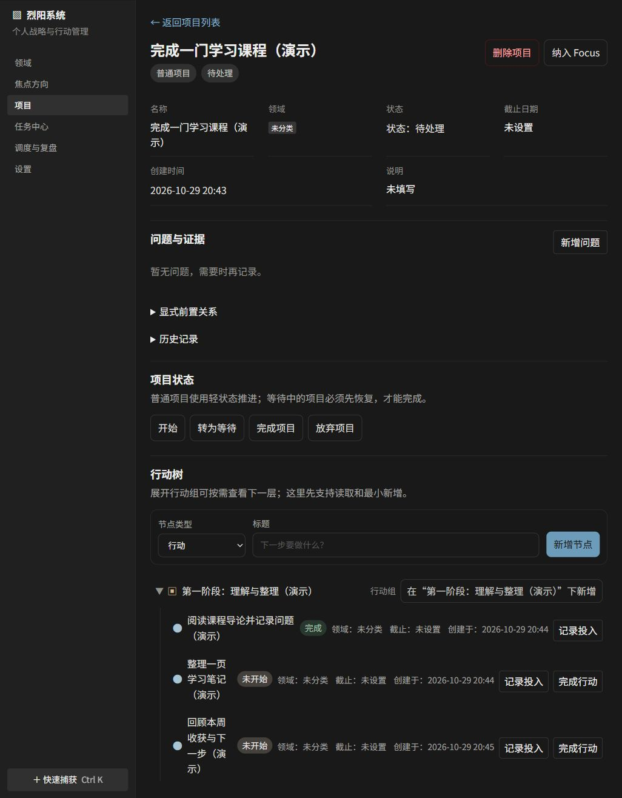
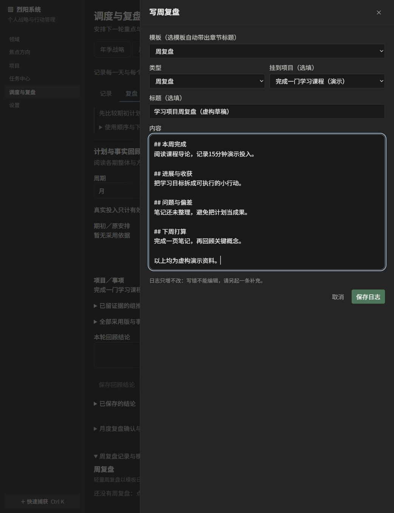

# 烈阳｜面向共同目标的个人与 AI 协作平台

**个人项目 · 开发中**

烈阳的长期构想，是让个人与 AI 围绕由本人确定的目标，共同参与规划、行动与复盘：将长期方向、项目推进和日常生活安排联系起来，让 AI 在获得授权的范围内理解上下文、提出建议、协助执行，并依据实际反馈帮助调整下一步。本人保留目标选择和正式采用的决定权。

当前 v0.1.0 是这一构想的阶段性原型，已围绕个人战略与行动管理建立基础功能，并接入受限 AI 协作。更完整的持续协作体验仍在探索与开发中。

**本人工作：** 主导功能规划与交互设计，运用 AI 编程工具开展原型开发。

**v0.1.0开发候选。运行安全发布检查尚未通过；本页用于项目展示，不提供在线服务或稳定安装包。** 以下全部为虚构演示资料。

当前原型的主要功能：

- **从项目到行动**：项目内组织行动组与具体事项，集中查看未完成工作。
- **从行动到记录**：完成行动时记录投入，保留执行事实；重试和失败由事务与回执规则保护。
- **从记录到调整**：支持年度、季度、月度、周度规划与复盘，结合执行记录调整后续安排。
- **与 AI 协作**：在授权范围内读取资料、提出建议和准备草稿；正式业务变更须经本人批准。AI 默认关闭，人工功能可独立使用。

示例流程：创建学习项目 → 拆成三条行动 → 完成一条并记录投入 → 回顾收获与下一步。复盘画面是未保存的编辑器，不表示已经提交复盘。

实现采用React／TypeScript、FastAPI／SQLAlchemy、PostgreSQL／Redis与Docker Compose。目前只在Windows＋Docker Desktop及指定浏览器环境中验证，另一台电脑和新Windows用户环境仍待测试。已知运行依赖风险尚未全部解决，不建议用于公网部署或真实敏感资料。

**源码保持私有。** 有兴趣进一步审阅，可[提交源码查看申请](https://github.com/Sterius154/lieyang-showcase/issues/new)，说明查看目的；由项目持有人决定是否开放访问。申请内容公开可见，请勿提交私人联系方式、账号凭据或敏感资料。公开介绍不自动授予源码访问权限，也不代表自有源码采用开源许可。查看者获准后仍可能下载复制源码。
